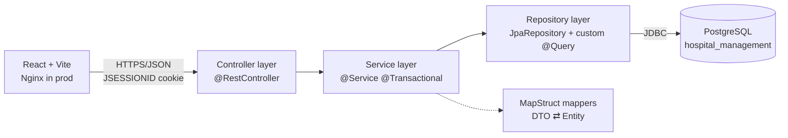
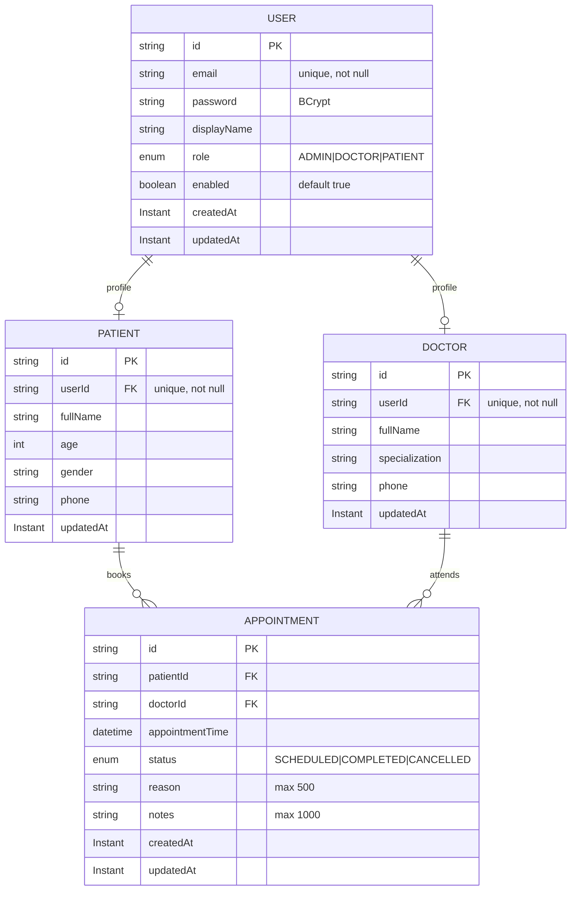
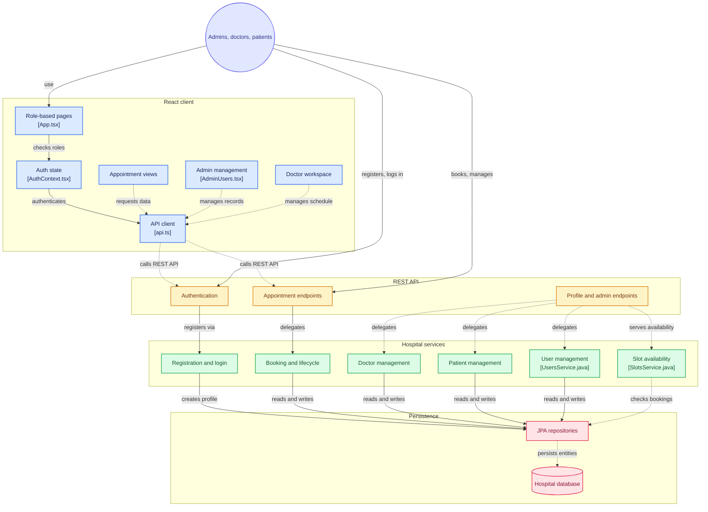

# MediCore - Smart Hospital Management

## Purpose

MediCore is a hospital management system with a Spring Boot REST API backend and a React + Vite frontend. It supports three roles — **ADMIN**, **DOCTOR**, and **PATIENT** — with session-based login, patient self-registration, doctor management, appointment booking, slot availability, and doctor notes.

- **Admins** manage users, doctors, patients, and appointments.
- **Doctors** manage their own appointments and notes.
- **Patients** book and cancel appointments.

## Tech Stack

- **Backend:** Java 21, Spring Boot 4.1.1 (Spring Security, Spring Data JPA, Spring Web MVC, Validation, Actuator)
- **Build Tool:** Maven (use the included `mvnw` wrapper)
- **Mapping:** MapStruct 1.6.3 + Lombok
- **Database:** PostgreSQL (H2 is also on the classpath for local runs)
- **Frontend:** React 18 + Vite + TypeScript + Tailwind, SWR for data fetching, Zod for validation
#- **Docs:** springdoc-openapi (Swagger UI)

## Prerequisites

- JDK 21+
- Node.js 18+ and npm (for the frontend)
- PostgreSQL 14+ (or use the H2 fallback)
- Maven (or use `./mvnw`)

## Database Setup

1. Create the database:

   ```sql
   CREATE DATABASE hospital_management;
   ```

2. Configure the connection (URL, username, password) in `src/main/resources/application.properties`, or override with environment variables.
3. For a quick local run without PostgreSQL, use the H2 fallback instead.

## Running Locally

## Clone the repo
```bash
git clone https://github.com/rdm-code/medicore.git
```
## After cloning

```bash

cd medicore

# Backend
cd hospitalmangement
./mvnw spring-boot:run

# Frontend (in a separate terminal)
cd frontend
npm install
npm run dev
```
## Deploying in docker

```bash
sudo docker compose up --build
```
---

# API Documentation

## Endpoints

| Method | URL | Description | Request body | Success | Error |
|---|---|---|---|---|---|
| POST | `/api/auth/register` | Public patient self-registration | `PatientCreateDTO` | 201 | 400, 409 |
| POST | `/api/auth/login` | Session login, returns email + role | `LoginRequestDTO` | 200 | 400, 401 |
| GET | `/api/auth/me` | Current logged-in user | – | 200 | 401 |
| POST | `/api/auth/logout` | Ends session (handled by SecurityConfig) | – | 204 | – |
| GET | `/api/admin/users` | List users | – | 200 | 401, 403 |
| GET | `/api/admin/users/{id}` | Get user | – | 200 | 404 |
| POST | `/api/admin/users` | Create user | `UserCreateDTO` | 201 | 400, 409 |
| PUT | `/api/admin/users/{id}` | Update user | `UserUpdateDTO` | 200 | 400, 404, 409 |
| DELETE | `/api/admin/users/{id}` | Delete user | – | 204 | 404 |
| POST | `/api/admin/doctors` | Create doctor (creates user + profile) | `DoctorCreateDTO` | 201 | 400, 409 |
| PUT | `/api/admin/doctors/{id}` | Update doctor | `DoctorUpdateDTO` | 200 | 400, 404 |
| DELETE | `/api/admin/doctors/{id}` | Delete doctor | – | 204 | 404 |
| GET | `/api/doctors` | List doctors, optional `?specialization=` | – | 200 | 401 |
| GET | `/api/doctors/{id}` | Get doctor | – | 200 | 404 |
| GET | `/api/doctors/me` | Doctor's own profile | – | 200 | 403, 404 |
| PUT | `/api/doctors/me` | Doctor updates own profile | `DoctorUpdateDTO` | 200 | 400, 404 |
| GET | `/api/doctors/{id}/available-slots?date=YYYY-MM-DD` | Free 30-min slots | – | 200 | 401, 404 |
| GET | `/api/patients` | List patients (ADMIN) | – | 200 | 403 |
| GET | `/api/patients/{id}` | Get patient (ADMIN) | – | 200 | 403, 404 |
| GET | `/api/patients/me` | Own patient profile | – | 200 | 403, 404 |
| PUT | `/api/patients/me` | Update own profile | `PatientUpdateDTO` | 200 | 400, 404 |
| PUT | `/api/patients/{id}` | Admin update patient | `PatientUpdateDTO` | 200 | 400, 403, 404 |
| DELETE | `/api/patients/{id}` | Admin delete patient + user | – | 204 | 403, 404 |
| POST | `/api/appointments` | Patient books | `AppointmentCreateDTO` | 201 | 400, 403, 404, 409 |
| GET | `/api/appointments/me` | My appointments (PATIENT/DOCTOR) | – | 200 | 403 |
| GET | `/api/appointments?status=&doctorId=` | Admin list | – | 200 | 403 |
| GET | `/api/appointments/{id}` | Get one (participant or admin) | – | 200 | 403, 404 |
| PATCH | `/api/appointments/{id}/cancel` | Cancel (participant or admin) | – | 200 | 403, 404, 409 |
| PATCH | `/api/appointments/{id}/complete` | Complete (doctor or admin) | – | 200 | 403, 404, 409 |
| PATCH | `/api/appointments/{id}/notes` | Doctor adds notes | `AppointmentNotesDTO` | 200 | 400, 403, 404, 409 |
| DELETE | `/api/appointments/{id}` | Admin delete | – | 204 | 403, 404 |

---

# MediCore Design

## Problem Statement

Hospitals juggle patients, doctors, and appointments across paper and spreadsheets. MediCore centralizes this in one REST API with role-based access: admins manage accounts and doctors, doctors see and complete their schedule and write notes, patients self-register, view available slots, and book/cancel appointments. The system must prevent double-booking of a doctor's time slot and enforce role permissions on every endpoint.

## Layered Architecture



## Entity Relationship Diagram



## Architecture Design



[](https://gitdiagram.com/rdm-code/medicore?utm_source=readme&utm_medium=picture)

<!-- [](https://gitdiagram.com/rdm-code/medicore?utm_source=readme&utm_medium=badge) -->
